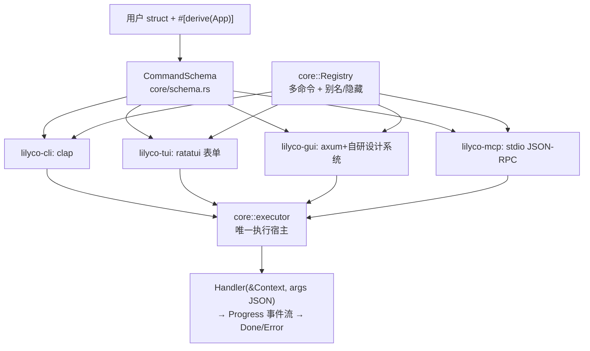

# Lilyco Codegraph — AI / Agent 代码图谱

> 给 AI Agent 和新贡献者的**唯一导航入口**。所有符号引用带 `文件:行号`，可直接跳转。
> **维护规则**：任何 PR 改动下述符号（新增/移动/改名/删除）必须同步更新本文件 —— 让图谱随代码漂移等于没有图谱。

## 0. 30 秒心智模型

**一个 struct 派生四个界面**：用户在业务 struct 上 `#[derive(App)]`，宏生成 `CommandSchema`（机器可读的命令描述），四个后端把同一份 schema 渲染成 CLI / TUI / Web / MCP，执行统一走 `core::executor`。



## 1. Workspace 依赖（严格单向，禁止反向）

### 应用扩展：素材工坊

`apps/asset-studio/` 是独立的本机 FastAPI + React/shadcn 前端，调用已编译 `laic`，不复制解析器或 core 执行器。
入口 `launcher.py:17`（Windows WebView2 / Linux 浏览器）；路由装配 `studio/app.py:35`；固定 CLI 适配器 `studio/adapters.py:29`；
子进程任务与取消 `studio/jobs.py:26`；受限工作区路径 `studio/paths.py:14`。
只在 loopback 提供服务，以 Host/Origin/随机会话 Cookie 保护文件与 API。
不接受 shell 命令或可执行路径，不向 WebView 脚本暴露 Python API。Spine 播放适配器只连接可信引擎；
公共 CI 构建 AIC 包，维护者独立授权流程构建 AIC + Spine 3.8 产品包，携带单独 Runtime 许可，不能把它当 MIT 分发。
前端入口 `ui/src/studio-entry.tsx`，界面 `asset-studio-workspace.tsx`，工作区和任务状态 `use-asset-workspace.ts`；
原始 shadcn 组件只读，语义色与明暗主题在 `studio-theme.css`，约束见 `DESIGN.md`。
验证和完整包构建仅由 GitHub Actions 执行；包含自制 PXLS 的真实原生引擎往返、桌面/手机布局、
打包后真实 WebView2、关闭清理、安装/卸载验收。NSIS 卸载验收显式复制原卸载器到测试目录，
以官方 `_?=$INSTDIR` 参数等待真正的卸载进程结束并核对退出码，再验证全部包文件、开始菜单及用户文件保留，
不把启动卸载器的父进程退出误判为全部清理结束。`packaging/build-app.py` 是统一冻结配方，
`packaging/windows-installer.py` 仅删除明确列出的应用文件，禁止递归卸载用户目录。
Windows SDK 署名由 `apps/asset-studio/tests/notices.py` 对固定官方 NuGet 包、完整许可及五个真实冻结 DLL 做字节核对。
`packaging/webview2-sdk.json` 固定官方来源和摘要；公共包与授权组合包都必须携带独立 SDK 许可，
不能用 pywebview 或 Spine 的许可替代。公共 Asset Studio workflow 也运行完整 workspace fmt/clippy/test 门。

### 应用扩展：图片工坊（Vision Studio）

已构建包的独立字节审查与发行由 `scripts/reviewed_vision_release.py:103`（`inspect`）和
`.github/workflows/reviewed-vision-release.yml` 执行。
只接受已成功的正式 main 产品 workflow；核对全部 source gates、外层 artifact 摘要、ZIP 全文件清单与摘要、
官方 SDK 五 DLL／完整许可、八个原工具、冻结／原生／安装卸载和各尺寸真实交互证据。
PR 与 push 仅审查，不发布；显式 main dispatch 且发布器主线与完整 workspace 门通过才创建六资产 draft，
GitHub 资产摘要与大小全部匹配后公开，已公开的不同文件永不覆盖。不通过本机下载／编译规避门禁。
未公开 draft 通过认证后的分页列表定位唯一 tag，再按固定 release ID 核验目标与资产；
不依赖仅查询已公开发行的 tag 端点，不在失败后重复创建同名草稿。

`apps/vision-studio/launcher.py:17` 提供本机 WebView2 / 浏览器入口；`studio/app.py:26` 是 loopback HTTP 组合根，
Host / Origin / 按端口随机 HttpOnly Cookie 隔离应用窗口，文件保存在临时工作区；`studio/paths.py:13` 限制下载路径。
`studio/adapters.py:44` 固定工具与文件路径、像素资源上限，禁止任意命令/输出路径；参数领域语义仍由原 Rust `CommandSchema::validate_args` 校验。
`studio/mcp.py:12` 通过标准 JSONL stdio 调用已编译 `lvision --mcp`，接收进度、120 秒超时、取消清理子进程树。
先从原 MCP tools/list 发现实际工具与参数拼写；Windows 用 `studio/windows_process_job.py` 的 nested Job 包住这次引擎及其后代，关闭前等待 ActiveProcesses=0；Unix 用独立进程组，不按浏览器名称全局杀进程。
`studio/jobs.py:13` 仅管理 HTTP 任务生命周期和真实导出，不重写 Rust core 的线程/进度执行宿主。
UI 使用 `ui/src/vision-workspace.tsx` / `use-vision-workspace.ts` / `vision-tools.ts`，原 shadcn 源组件保持只读。
`ui/src/vision-crop-preview.tsx` 把指针框选映射到原图像素坐标，保留键盘参数输入；图片信息直接显示格式、尺寸与文件大小。
八工具来自 `lilyco-vision/src/main.rs:44` 注册表；截图 URL `screenshot.rs:117` 归一化 Windows 扩展路径并转义，
截图命令 `screenshot.rs:146` / `run_html_screenshot:175` 使用临时 profile，
不会复用个人浏览器 Cookie。背景提取是确定性边界洪水填充，不宣传为 AI 抠图；HTML 需已安装 Chrome / Edge。
截图 profile 位于输出所在目录；`studio/profile_cleanup.py:8` 记录调用前已有 profile，只清理本次新增且未越界的目录。
在当前进程树退出后，Windows 临时文件句柄释放最多等待 5 秒；持续锁定仍报失败，不能在取消接口里覆盖成成功。
真实取消回归先等待浏览器创建 Default profile，再确认原进程退出及 profile 全部消失；另覆盖瞬时锁定、持续锁定和保留已有目录。
`.github/workflows/vision-studio.yml` 是唯一构建/测试入口：原八工具的真实像素、透明度、SVG 和 HTML 截图、
HTTP 边界、320–1440 响应式、冻结程序、原生 WebView2、正常关闭、安装与安全卸载。
包携带完整依赖许可、锁文件、原始输出和逐文件 SHA；当前分支未过门前不称为已发布。
Windows 包在 `tests/notices.py` 对 `packaging/webview2-sdk.json` 固定的官方 NuGet SDK、独立 BSD 文本及五个实际冻结 DLL 做字节核对；`packaging/archive.py` 携带 SDK 许可和来源清单，不能把 pywebview 源许可当成这些 SDK 程序集的许可。


| crate | 版本 | 依赖 | 职责一句话 |
|---|---|---|---|
| `lilyco-core` | 0.3.0 | serde/thiserror | 领域模型 + 执行语义 + 校验，零 UI 依赖 |
| `lilyco-macros` | 0.3.0 | syn/quote | `#[derive(App)]` / `#[derive(ValueEnum)]` 代码生成 |
| `lilyco-cli` | 0.3.0 | core + clap | schema → clap 渲染 + 内置标志 + 输出格式化 |
| `lilyco-tui` | 0.3.0 | core + ratatui | ratatui 表单状态机（单/多命令），不持有执行逻辑 |
| `lilyco-gui` | 0.3.0 | core + axum/tokio | Web 控制台 + SSE 进度 + 回环安全中间件 |
| `lilyco-mcp` | 0.3.0 | core（零额外依赖） | MCP 2024-11-05 stdio 服务器 + 进度通知 |
| `lilyco` | 0.2.3 | 全部 | **唯一组合根**：后端自动选择 + 各形态入口 |
| `lilyco-dev` | 0.3.0 | facade | **元 CLI**（bin `lilyco`）：`new` 脚手架 / `build` / `run` / `doc` 能力表 —— 它自己就是四命令的 dogfooding 样板 |
| `lilyco-vision` | 0.3.1 | facade + image + vtracer + tempfile | 原有八视觉工具；截图独立临时 profile，图片工坊通过 MCP 复用 |

Android/Termux：`lilyco --no-default-features` 剩 CLI+MCP（crossterm/axum 被特性门控）。

## 2. lilyco-core（领域核心）

| 符号 | 位置 | 说明 |
|---|---|---|
| `trait App` | `lilyco-core/src/app.rs:10` | `schema()` + `from_args()` + `run(&Context)`；宏自动实现 |
| `trait Renderer` | `lilyco-core/src/app.rs:22` | `render(&CommandSchema) -> Output`，各后端实现 |
| `struct CommandSchema` | `lilyco-core/src/schema.rs:40` | 命令的机器可读描述（四端渲染的唯一事实源） |
| `enum ArgKind` | `lilyco-core/src/schema.rs:21` | Flag/Text/Number{min,max}/Enum/Path{must_exist}/List |
| `validate_args()` | `lilyco-core/src/schema.rs:105` | **三端唯一参数校验实现**（required/range/enum/must_exist/List 递归） |
| `to_json_schema/openai/anthropic` | `lilyco-core/src/schema.rs:49,73,85` | AI tool 定义导出 |
| `type Handler` | `lilyco-core/src/registry.rs:23` | `Arc<dyn Fn(&Context, &Value) -> Result<Value, AppError>>` |
| `struct Registry` | `lilyco-core/src/registry.rs` | 多命令注册表；`register:148` `get(含别名):163` `visible:180` `from_json:194` `with_policy`（**必须在 `register` 之前调用**：门在注册时包住 handler） |
| `RegisteredCommand::from_app` | `lilyco-core/src/registry.rs:92` | App 类型 → 注册表条目（零样板入口） |
| `spawn()` / `execute()` | `lilyco-core/src/executor.rs:35,92` | **唯一执行宿主**：后台线程 + 进度 channel |
| `struct Task` | `lilyco-core/src/executor.rs:20` | `cancel` + `rx` + `handle` |
| `enum Progress` | `lilyco-core/src/progress.rs:10` | Started/Tick/Log/Done/Error，serde tag=`type` |
| `Context` | `lilyco-core/src/context.rs` | handler 上报进度：`emit:71` `tick:81` `log:92` `done:100` `is_cancelled:76` |
| `trait HostBridge` | `lilyco-core/src/context.rs` | handler 反向调用宿主的唯一接口：`ctx.sample()`（MCP sampling/createMessage）/ `ctx.roots()`；CLI/TUI/GUI 不接桥，返回带指引错误 |
| `enum AppError` | `lilyco-core/src/error.rs` | InvalidArg/InvalidInput/Runtime/Cancelled |

## 3. 四个后端

### lilyco-cli（`lilyco-cli/src/`，按职责分文件；对外只有 `CliRenderer` / `run` / `run_registry` / `build_registry_command`）
| 符号 | 位置 | 说明 |
|---|---|---|
| `struct CliRenderer` | `renderer.rs:27` | schema → clap 的渲染入口；`handle_builtin_flags():46`、`output_format():90`、`extract_args():103` |
| `run::<A>()` | `single.rs:17` | 单命令一行启动（clap 校验 → extract → executor → drain） |
| `run_registry()` | `registry.rs:28` | **多命令**：Registry → clap 子命令树；根级 `--schema` 打印清单 |
| `build_registry_command()` | `registry.rs:55` | 纯函数构建根 Command（别名/隐藏→hide(true)） |
| `resolve_registry_command()` | `registry.rs:82` | 规范名/别名 → 注册表条目（含 schema.name 兜底） |
| `drain_events()` | `registry.rs:114` | 单/多命令共用的进度消费（Human/Json/JsonStream） |
| `build_command()` / `add_builtin_flags()` | `command.rs:17` / `command.rs:133` | 构造规则本体：一个 `ArgKind` 怎么变成 `clap::Arg` |

### lilyco-tui（状态机，三文件）
| 符号 | 位置 | 说明 |
|---|---|---|
| `enum AppState` | `lilyco-tui/src/renderer.rs:43` | CommandSelect → Form → Confirm → Running → Done/Error |
| `struct TuiApp` | `lilyco-tui/src/app.rs:13` | `new():31` 单命令；`new_multi():46` 多命令（mininterface picker 模式） |
| `handle_event()` | `lilyco-tui/src/app.rs:81` | 按状态分发；Done/Error 后多命令回选择页 |
| `struct FormRenderer` | `lilyco-tui/src/renderer.rs:14` | `validation_errors():131`（提交前校验）、`cli_preview():98` |
| `struct FormField` | `lilyco-tui/src/widgets.rs:73` | 携带 `ArgKind` 约束；`validate():99` 与 core validate_args 同语义 |
| `render_command_select()` | `lilyco-tui/src/renderer.rs:238` | 多命令选择页（↑↓/jk + Enter） |
| `path_complete()` | `lilyco-tui/src/app.rs` | Path 字段 Tab 目录补全（readline 风格循环候选；`split_dir_prefix` 兼容 `/` 与 `\`） |

### lilyco-gui（`lilyco-gui/src/`，按职责分文件；对外只有 `GuiRenderer` / `RunnerFn` / `TOKEN_HEADER`）
| 符号 | 位置 | 说明 |
|---|---|---|
| `serve_app::<A>()` | `lib.rs:158` | 单命令：**内部建单命令注册表**再走 `serve_registry`（只有那条路登记取消句柄，见 DESIGN.md §8.6）；`serve(schema, runner):78` 是给自定义 runner 的逃生口（页面据此不画「取消」） |
| `serve_registry()` | `lib.rs:94` | **多命令**；`GET /?cmd=xxx` 渲染对应表单 + 下拉切换 |
| `serve_state()` | `lib.rs:113` | 路由器装配处：六个端点 + `security_mw` 一道闸（**新增端点只改这里**） |
| `security_mw()` | `security.rs:63` | 回环 Host 校验 + Origin 校验 + 随机 Token（防 DNS rebinding/CSRF）；`PROTECTED_POST:21` 是那份端点清单 |
| `AppState` | `state.rs:17` | schema / registry / sessions / cancels / token 一处真相（`pub(crate)`，测试夹具在同文件 `fixture`） |
| `pick_command()` | `render.rs:32` | `?cmd=` → 可见命令（别名命中；隐藏回退第一个可见） |
| `index()` | `render.rs:44` | 只做装配：取 schema → 拼组件 → 填模板 → 挂响应头（含 `no-store`，见 DESIGN.md §8.4） |
| `render_field()` | `render.rs:122` | **一个 `ArgKind` 一个组件函数**（`widget_flag/text/number/enum/path/list` + `field_shell`/`dropzone`/`pick_button`/`list_row`/`command_nav`），转义在 `Field` 里算一次 |
| 前端组件装配 | `assets/index.html` | 一个组件一个 `init*` + 末尾一行 `BOOT`；`initDropzone` 负责拖拽区里三个控件的点击分流 |
| 设计令牌与组件目录 | `lilyco-gui/DESIGN.md` | §1–§6 颜色/间距/排版/圆角/动效/响应式的**唯一一张表**（`app.css` 只许引用表里的值），§7 DOM 契约，§10 每个组件的构成/七态/令牌/无障碍 |
| `run_handler()` | `run.rs:88` | `/run`：多命令按 `req.cmd` 显式分发（未知/隐藏 → 400，**绝不静默换命令**）；单命令 runner 模式直接 spawn 调用方的 `RunnerFn` |
| `run_progress()` | `run.rs:45` | 唯一会登记取消句柄的执行循环：handler → `executor::spawn` → SSE 事件转发 → 终态清理 `cancels`（`/cancel` 只找得到这条路上的会话） |
| `upload_handler()` | `files.rs:98` | 拖拽上传 → base64 → 服务端临时副本（净化文件名 + 双重体积上限） |
| `pick_handler()` | `files.rs:201` | 本机原生选择器 → 回填**原始路径**（`pick` 特性；`flash_picker_when_ready:160` 治前台锁定） |

### lilyco-mcp（`lilyco-mcp/src/`；对外只有 `McpServer` + 协议常量）
| 符号 | 位置 | 说明 |
|---|---|---|
| `handle_line()` | `server.rs:35` | 纯函数：一行请求 → 一行响应（通知返回 None） |
| `handle_line_with_sink()` | `server.rs:44` | 流式版：进度通知逐行回调 |
| `tools_call()` | `server.rs:238` | 先 `validate_args`（错误 → INVALID_PARAMS），带 `_meta.progressToken` 时 spawn 流式执行 → `notifications/progress` |
| `serve()` / `serve_stdio()` | `server.rs:101` / `server.rs:208` | 双向 JSON-RPC 分流：客户端请求→dispatch（tools/call 进 worker 线程），客户端响应→pending 表路由给等待中的 handler |
| `protocol.rs` | `progress_notification():14`、`initialize_response():37` | JSON-RPC 报文装配与协议常量（线格式只在这一层） |
| `McpBridge` | `bridge.rs:37` | HostBridge 实现：`sampling/createMessage` / `roots/list` 反向请求；`srv-N` 字符串 id 防冲突；initialize 探测客户端能力门控 |

## 4. facade `lilyco`（唯一组合根，`lilyco/src/lib.rs`）

| 符号 | 行 | 说明 |
|---|---|---|
| `detect_backend()` | 122 | `--mcp/--gui` > `LILYCO_UI` > 终端探测（TUI 失败回退 CLI） |
| `run::<A>()` / `run_with()` | 165 / 170 | 单命令四端自动选择 |
| `serve_mcp()` | 189 | 注册表 → MCP 服务器 |
| `run_cli_registry()` | 206 | 注册表 → clap 子命令 |
| `run_tui_registry()` | 220 | 注册表 → TUI 命令选择页（起不来回退 CLI 多命令） |
| `run_web_registry()` | 243 | 注册表 → Web 控制台（`?cmd=` 下拉 + `/run` 显式分发） |
| `run_registry()` | 282 | **多命令一行启动**：按 `detect_registry_backend()` 自动分发 |
| `run_registry_with()` | 300 | 显式指定后端；**按调用面注入 SafetyPolicy**（MCP→`DenyElevated`，其余→`Interactive`） |
| `run_registry_with_policy()` | 315 | 调用方自带策略（逃生舱，业务通常不要用） |
| `detect_registry_backend()` | 392 | 多命令形态探测：**自动探测出的 TUI 降级为 CLI**（裸跑不该被拽进交互界面；进 TUI 须显式 `--tui`） |
| `build_multi_tui()` | 488 | 纯函数：注册表 →（选择页 TuiApp + 名字→handler 表）。与事件循环分离以便无 TTY 单测（隐藏命令过滤、空注册表报错） |
| `into_registry_with_policy()` | 342 | 对已有注册表重建以换策略（**兜底**：只能替换，不能解开已包在 handler 上的旧门） |
| `run_tui_event_loop()` | 515 | 单/多命令共享的 TUI 循环（非阻塞 drain + 可取消） |

## 5. 多命令语义对照（四端对齐）

| 语义 | CLI | TUI | Web GUI | MCP |
|---|---|---|---|---|
| 可见命令 | 子命令 + help | 选择页列表 | `?cmd=` + 下拉 | tools/list |
| 别名 | clap alias + registry 解析 | —（列表不显示） | `registry.get` 命中 | `registry.get` 命中 |
| 隐藏命令 | 可调用，help 不显示 | 不可见 | 不可导航；`/run` 显式调用 → 400 | get 可命中，tools/list 不显示 |
| 参数校验 | clap（解析层） | `FormField::validate`（提交前，同语义） | `validate_args`（服务端 400）+ HTML5 | `validate_args`（INVALID_PARAMS） |
| 进度 | stdout / json-stream | 非阻塞 drain | SSE | `notifications/progress`（带 token 时） |

## 6. 不变量（改代码前必读）

1. **executor 是唯一执行宿主**：任何"线程 + channel + 进度消费"的新实现都是重复 —— 加后端 = 渲染层 + 一处 `spawn` 调用。
2. **`CommandSchema::validate_args` 是唯一校验实现**：TUI `FormField::validate` 是其表单侧映射；新增校验规则先改 core，再同步 TUI。
3. **事件流协议**：`rx` 恒以 `Done`/`Error` 结尾（`executor::spawn` 合成兜底）——消费者无需自己兜底。
4. **依赖单向**：core 不依赖后端，后端互不依赖，facade 是唯一知道所有后端的 crate。
5. **clap 只接受 `'static str`**：运行时字符串用 `leak_str`（`lilyco-cli/src/command.rs:13`，Box::leak，进程内无累积问题）。
6. **导航可回退、执行不可回退**：`index` 的 `?cmd` 未知时回退第一个可见命令；`/run` 显式指定未知命令必须 400。
7. **宏展开引用 `::lilyco::__core::`（facade doc-hidden 再导出）**：用户只需依赖 `lilyco` 一个 crate；直接使用 `lilyco-macros` 的项目须同时依赖 `lilyco`（macros 的 dev-deps 即此契约）。
8. **安全策略按「调用面」注入，且在 `register` 之前**：`Registry::with_policy` 在注册时就把 handler 包进门，所以顺序不能反；`run_registry_with` 按后端选策略 —— **MCP = `DenyElevated`（自动化面，fail-closed）**，**CLI/TUI/Web = `Interactive`（人类在环，放行 T1）**。这是四端"同一份 handler、不同信任级别"的唯一实现点。`into_registry_with_policy` 只能用于**尚未注册**的注册表；对已注册的调它会在 handler 上叠第二道门（旧门先拒），表现为"换了策略还是被拒"。
9. **MCP `serve()` 在 stdin EOF 后必须 join 在途 worker**：`tools/call` 丢到 worker 线程执行（为支持 handler 反向 `sampling/createMessage`），短连接客户端（脚本 / `echo … | server`）写完即关 stdin —— 不等 worker 就会丢响应。回归测试：`serve_waits_for_inflight_tools_call_on_eof`。

## 7. 扩展点（怎么加东西）

- **加一个命令**：写 struct + `#[derive(App)]`（可选 `#[app(name/about/run/safety/crate)]`，字段 doc comment 即描述）→ `registry.register(RegisteredCommand::from_app::<T>())`。四端自动获得。
  `crate = "lilyco_core"` 是给**不依赖 facade** 的嵌入方用的：默认展开成 `::lilyco::__core::…`，
  两条路径下的条目一一对应（facade 里就是 `pub use lilyco_core as __core`）。
- **加一个域二进制**：**最快路径 `lilyco new <name>`**（`lilyco-dev` crate，模板内嵌自 `scripts/domain-template/`，crate `lilyco-<name>` + bin `l<name>`）；手抄则照 `lilyco-files`（文件域）或 `lilyco-binfmt`（办公文件与容器结构域，`lbin`，12 条全 T0 只读）抄 `main.rs` 的 registry 装配 + 按调用面注入安全策略 → 根 `Cargo.toml` 的 `[workspace] members` 加一行 → 使用文档放 `docs/<域>.md`（`docs/lfiles.md`、`docs/binfmt.md`）。
  **完整清单（12 步，含 CI 枚举那一步）与可复制骨架见 [INTEGRATION.md](INTEGRATION.md) + `scripts/domain-template/`。**
  应用 crate 只依赖 `lilyco` 一个包：core 的类型（`Context` / `SafetyPolicy` / `SafetyTier` / `Registry`…）从 `lilyco::prelude::*` 拿，
  `derive(App)` 默认展开成 `::lilyco::__core::…` —— 不需要把 `lilyco-core` 写进 `[dependencies]`（`lbin` 已按这条清掉）。
- **加一个后端**：新 crate 只依赖 core，实现 `Renderer`；facade 加一行分发。参考 lilyco-mcp（最小样板 ≈ 350 行含测试）。
- **选后端 = 开特性，但只有一处该开**：`lilyco-core` **没有任何特性**（它是后端无关的领域层）；
  域 crate 一律 `default = ["full"]` / `full = ["dep:lilyco", "lilyco/full"]` / `android = ["dep:lilyco"]`；
  facade `default = []` + `full = ["tui","web","ultra"]`（后端各自 `dep:` 门控）；
  `lilyco-gui` 的 `pick` 只管它自己的原生文件选择器。
  新增域 crate 照这套命名，别再造 `headless` / `no-tui` / `cli` 这类同义词（core 原来那三个空壳特性就是这么来的，已删）。
- **加校验规则**：`schema.rs::validate_kind` + `schema.rs` 测试 + TUI `FormField::validate` 映射 + README 限制清单。
- **加进度事件**：`Progress` 枚举加变体（serde 兼容）→ 各后端消费者各加一臂。

## 8. 常用命令

```bash
cargo test --workspace            # 全量测试（984 项，见 readme 的 Testing 一节，含两个前置条件）
cargo fmt --all && cargo clippy --workspace --all-targets
cargo run -p lilyco-example --example multi -- ping --name 世界   # 多命令冒烟
cargo run -p lilyco-example --example multi -- --schema           # 注册表清单
cargo run -p lilyco-example -- --mcp                              # MCP 服务器冒烟
cargo bench -p lilyco-example                      # schema 生成性能基准
cargo run -p lilyco-dev -- new todo                # 元 CLI：脚手架 lilyco-todo（bin ltodo）
cargo run -p lilyco-dev -- doc --project lilyco-letsgal              # 元 CLI：能力表 CAPABILITIES.md + capabilities.json
```

发版：改各 crate 版本（本文件 §1 同步更新）→ commit → `bash scripts/publish.sh`（按依赖顺序全链发布；脚本用临时 CARGO_HOME 绕开 rsproxy 镜像滞后，验证构建走 crates.io 真实索引）。

## 9. 测试地图

| 区域 | 位置 | 覆盖 |
|---|---|---|
| core 校验/协议/registry | `lilyco-core/src/{schema,lib,registry}.rs` `#[cfg(test)]` | validate_args 12 例、Progress serde、registry 别名/隐藏/JSON |
| CLI | `lilyco-cli/src/tests.rs` | 渲染/解析/内置标志/多命令构建与解析（31 例） |
| TUI | `lilyco-tui/src/lib.rs` 底部 | 渲染、状态机、校验拦截、多命令选择页、路径 Tab 补全 |
| GUI | `lilyco-gui/src/{security,state,render,run,files,util}.rs` 各自底部 | run_handler 400/200、pick_command、?cmd 导航、转义、base64、文件名净化、`/pick` 同闸；**取消链**：registry 跑起来会登记句柄且终态清掉、runner 模式 `/cancel` 必 404；**组件契约**：六种 ArgKind 各自出组件且 `data-component` 自报、`List` 的行控件跟着 item 类型、JS 里每个 `init*` 都在 `BOOT`、装配行在脚本末尾（TDZ）、内联 JS 过 `node --check`、页面无内联事件、每个 `data-*` 都有人读、拖拽区 id 对得上 JS 的拼法、`no-store`、单边区间也要写进提示、`app.css` 的颜色字面量全在 DESIGN.md §1 那张表里、资源体积守 DESIGN.md §9 的上限、reduced-motion 下进度与 loading 留了静态替代 |
| MCP | `lilyco-mcp/src/tests.rs` | initialize/tools/进度通知/双向 serve/校验拒绝（26 例） |
| 门面 | `lilyco/src/lib.rs` 底部 | 后端探测 |
| 办公文件（同一个域） | `lilyco-binfmt/src/{zipread,xmlscan,cfb,props,rtf,word,biff,ppt,numfmt,odsheet,opack}.rs` 与 `{office_info,office_text,office_meta,office_doc,office_sheet,office_slide,office_package,office_objects}.rs` 底部 + `tests/fixtures/office/` | 解压必须过部件自报的 CRC-32；容器识别看部件名/流名不看后缀；OPC 关系按源部件目录解析、断头关系要报；`[Content_Types].xml` 的 Default 与 Override 两种声明都要认；CFB 链成环/越界就地截断并留话；MS-OPS 的属性集个数在偏移 24 不是 28、`VT_LPSTR` 按文件自报的 CodePage 解、VT_I2 按无符号读；RTF 控制字按词边界结束、`\*` 群整群跳过、`\uN` 按 `\ucN` 丢等价回退字符且 `\'hh` 只算一个；`.doc` piece 的压缩位（fc 除二 + cp1252）；BIFF8 的 SST 跨 CONTINUE 要重读 grbit、RK 的 bit0=除 100 / bit1=整数、BOUNDSHEET 可见性在 grbit 最低两位、格子的主人看 lbPlyPos（Workbook 流内字节偏移）而不是数 BOF 的次序；PowerPoint 97 记录树的表头是 recVer(+0)/recType(+2)/长度(+4)（三个已知原子落在 +2、整条流按此铺满才敢这么读）、容器只靠「正文能再铺成一条完整记录流」来判、TextCharsAtom 的高字节全零时才允许按 Windows-1252 低字节读；RTF 的 `\info` 要读到下一个非元数据目标为止（真件里 `\info{}` 只包住标题那一对 `\upr`）、`\upr` 只跳第一群（真值在 `\*\ud` 那边）、属性名按群整块交账、`\printim` 全零不能报成 0000-00-00；`--limit 0` 回退缺省而 `--max-bytes 0` 是不设上限（两种 0 不能混）；xlsx 的 `s=` 是 `xl/styles.xml` 的 `cellXfs` **下标**不是格式号（不绕这一层 41631 只是一个数）、自定义格式号从 164 起（openpyxl 把日期/百分比/货币全写成 164-168，内置表查不到）、格式串判类型要先剥引号字面量与转义和 `[...]` 段（反斜杠转义与引号包起来的字面量都不算格式标记，比如那个带「年/月/日」字面量的日期格式）、时间标记之后的 `m` 是分钟、换算看 `date1904`，而 1900 系统第 60 号是那个不存在的 1900-02-29：文件写着 60 就照 60 报、文本 `12/23/2013`（格式号 0）不许被猜成日期；`docProps/thumbnail.jpeg` 也声明成 image/jpeg，先认缩略图再认媒体，否则「有几张图」被一张预览图顶掉；OOXML 缺 `word/footnotes.xml` 就是 0 个脚注（只有遗留 `.doc` 真看不见，才给 null）；`office-text` 的 `index` 是「在这份列表里第几条」，正文与批注共用一条数，不能出现一条 9 夹在 7 与 10 之间、或两页各自从 0 数起；RTF 的 `\uc0` 说的是一个回退字符都不跳，那个 `?` 是正文；伪根 `#doc` 底下的纯空白永远不是内容（元素之间才用「带换行才丢」保住 `<w:t> </w:t>` 那个空格）。ODS 的格子内不写序列数（`office:date-value` 直接是 ISO 串，没有 1900/1904 基准要猜），位置靠 `table:number-columns-repeated` 累加（行尾那片空白一填就是 16381、行首也会重复 2 格，照字面数就成了一万六千格），覆盖格 `covered-table-cell` 单列一个数不当内容，表可不可见在它引的自动样式的 `table:display` 里，而 `calcext:value-type` 是 `office:value-type` 的实验区副本（按局部名乱抓会抓到它）；LibreOffice 在 `meta.xml` 自报的 `cell-count` 是第三方保证，两份读者都与它对账；`#doc` 的直接孩子是根元素：`root.child("body")` 永远找不到 `w:body`（它在 `w:document` 里一层），而计数走 `descendants` 又照样对 —— 于是假话只留在 notes 里，CI 跑完第三轮才露出来；ODF 文字的结构账在 `office:body > office:text`，脚注与尾注共用一个 `text:note`、靠 `note:class` 分家，批注是 `text:annotation`、图在 `draw:image` 的 `xlink:href`、标题层级在 `text:outline-level`，`meta:document-statistic` 是生产者自己写的段落/页/字数（拿来当第三方对账，而不是当自己的结论）；`office-text` 的页眉页脚那条分支是靠 `notes-hf.docx` 第一次走到真件的：python-docx 默认让第二节沿用第一节，必须 `is_linked_to_previous = False` 才会写出第二个 `header*.xml` —— 少了这一步，那条分支等于从来没被测过；ODP 的备注只认 `presentation:notes` 里 `presentation:class="notes"` 那个框，同级的 page-number 框里是样字 `<编号>`（整页 `descendants("p")` 一把抓就会把它读成正文），页名在 `draw:name`（`attr("name")` 取不到，得按局部名）、尺寸四跳 `draw:master-page-name` → styles.xml 的 `style:master-page` → `style:page-layout-name` → `style:page-layout-properties`，而 `presentation-page-layout-name` 只是名字（这份文件里一个版式定义都没有）；ODF 的批注是嵌在正文段里面的 `text:annotation`（作者/时间在 `meta:creator`、`meta:date` 这些**子元素**上，不是属性），整段 itertext 一把抓会把它接进正文，而 LibreOffice 自报的 paragraph-count 正是因为它把批注里那段也数了（10 = 9 正文 + 1 批注）；16 份 fixture 全由独立生产者写，期望值来自 `scripts/acceptance/office_reader.py`，CI 里 `office_probe.py` 与它逐字段对账 |
| 域二进制 | `lilyco-binfmt/src/{main,read,entries,regions,symbols}.rs` 底部 | 注册表形状/全 T0/工具导出/参数拒绝；魔数判别（Java class ≠ 通用二进制）、tar 八位校验和、PNG 真算 CRC、ELF 头部只到 `e_ehsize`、Mach-O 端序与定长 16 字节节名、零填充节不画成数据 |
| 端到端 | `lilyco-example/tests/integration.rs` + `examples/multi.rs` | 图片压缩全链路 + 多命令演示 |
| 性能基准 | `lilyco-example/benches/schema.rs` | schema 生成 / 导出 / 校验 / Registry 装配（`cargo bench -p lilyco-example`） |
| aic 域 | `lilyco-aic/src/{pxlslib,unityfs,serialized,atlas,util}.rs` + `{poses,frame,findpose,tex,mpcc,sprites,render,animate,repack,pack}.rs` 底部 | 注册表形状/10 条=8×T0+repack/pack 两条 T1（MCP 拒/CLI 放）/工具导出/缺参拒绝；pxls 磁盘大端（u16 字符串、u32 子流），`serialize` 是 `parse` 的严格逆（PACK/IMGS/POSE 结构化重写、IMGV/PTCL/IMGD/尾部透传，全表逐字节回环测试）；UnityFS version≥7 读完 flags 16 字节对齐、LZMA1 无 size 头补 alone 头（可早停取元数据前缀）、节点表 offset/size u64 切 resS，`repack` 重压分块+重建头/块表/节点表；签名定位容错（真 parse 验候选+长度前缀收边，防把后续 AssetBundle 复制一份）；Unity `TextureFormat` 全表（12=DXT5/BC3、29=DXT5Crunched，曾错位致 71 张图集解成噪点，`format_size_ok` 与编号表测试钉住），块格式先验长度守卫；图集按 asset 名后缀 `_<i>` 配对（`noel_t` 对象表倒序，resolve-once + ordinal 直读，读像素级回归测试）；SerializedFile v22 48B 头（版本串从 @48 起）、typetree blob 节点首 i16 是 version 非 level、CommonString 114 条、MetaFlag 0x4000 对齐、TypelessData 无 Array 包装（3 节点）而 string/vector 有（4 节点）、string len 不含 null，解析时记 `file_size_at`/`obj_table_at` 供写回修补（正文差与对齐后对象差分开记，skew 恒 ±3 内）；noel 真值 232B 对象全字段断言；MPCC 深层 ACC 调色板（`XX.mobpxl.MobPCCContainer`，在 unsafeAssem.dll）：byte占位×2 + string name/chr_name + byte ARMX + ARMX×{pstring key, byte 操作数, ACC×操作}，类型 1=HSV(i16 h, u8 s, u8 v, u8 flags) / 2=TONECURVE(byte 通道数, 每通道 byte 点数 + 点×2B)；三处游戏怪癖必须照抄——s/v 读入后 >=127 再减 256、操作类型 0 丢弃但字节照吃、操作数<=0 的部件直接 continue（`dropped` 如实报出，此时回环必然不成立）；部件表存 Vec 保序（游戏写回走 X.objKeys 字典插入序）；每份文件**逐字节**回环自证 roundtrip_ok（只比 len() 会让同长度不同内容静默通过）|

### 桌面软件图标链路

apps/desktop-common/desktop_icons.py:11 prepare_icon：仅在 Actions 从固定哈希原创 PNG 生成透明 16/24/32/48/64/128/256 ICO 与 PNG；:55 verify_embedded_icon 逐帧核对 EXE/NSIS 的实际 PE 资源。asset-studio 与 vision-studio 的 packaging/build-app.py 传 --icon 并打包 resources，windows-installer.py 配置安装/卸载图标并写独立收据。两个 tests/test_desktop_icons.py 验证透明尺寸、哈希拒绝与仅CI约束；ui/index.html 使用 /assets/app-icon.png，资源随实际 UI 构建保留。

原生窗口用 pywebview.start(icon=...) 的官方路径；启动回调 record_window_icon 将实际 WinForms Icon 保存为原始 ICO 字节并与包内 ICO 比对，验收必须收到 native_icon_applied=true。没有依赖跨线程写 UI 的 shown 回调。

素材工坊真实引擎测试 `apps/asset-studio/tests/test_studio.py:35` 的 `run_job` 用 monotonic 30秒有界轮询并检查HTTP200；shared Windows runner 的24帧512×512 Spine渲染可能超过旧5秒。原始帧差异、GIF透明像素、导出与失败状态断言均保留；生产jobs的120秒限时和取消行为不变。

### 发行边界：现有 office Tauri 桌面端

`lilyco-tauri/src/lib.rs` 注册 `commands::office_commands` 和 `office_run`；
`tauri.conf.json` 明确使用原生 `binaries/lbin` sidecar，不是截图或空网页。
办公字段仍由相同 lilyco-binfmt 原CLI读取；安装文件存在不等于全部GUI验收完成。
Desktop workflow仅把 `v[0-9]*` 框架版本标签传给Tauri release上传。
`vision-studio-*` 虽然以v开头，但不属于框架版本，不能再把office bundle挂进Vision Release。
已上传的文件保留，防止破坏他人下载；Source/GUI/icon/install验收另行核实。

Desktop 的 workflow 同时复用 Asset Studio 已验证的完整 `workspace-contract`：真实 `lbin` sidecar、`cargo fmt --all -- --check`、`cargo clippy --locked --workspace --all-targets` 与 `cargo test --locked --workspace`；不以仅覆盖部分 crate 的通用 CI 代替 AGENTS 全 workspace 门。

### Office 0.3.1 · 原始 Lyco 图标及包内验证

`lilyco-tauri/desktop_icons.py` 是 Actions 专用资源配方：原始 PNG 与完整角色许可固定摘要；官方 Tauri CLI 2.12.1 生成 ICNS，共享 `apps/desktop-common/desktop_icons.py` 生成已审查的七尺寸 ICO。前端 favicon/标题图使用同一原图并署名，独立角色许可由 bundle.resources 装入；软件代码许可不变。Office crate/lock/config 版本单独升至 0.3.1，其他 crate 版本不改。
Desktop 的 workspace-contract 与三平台 bundle 在编译前都准备图标；Windows 实际 EXE/NSIS PE 原始图像帧、macOS .app ICNS、Debian PNG 载荷逐字节验证，再保存 icon-build/icon-package-evidence。MSI 目前仅证实生成，并非实际安装/卸载验收；这一步不证明整个 Office 高级 UI 和销售交付已经完成。不使用编译前“文件存在”冒充包内验证，不本机执行转换/测试/构建。

Office 图标包暂只保存 Actions 产物，不在 tauri-action 构建阶段公开上传（平台资源检查发生在其后）。后续仍须真实原生界面、安装/卸载与许可审查，再经独立审核发行；不能先公开再验证。

Office Windows图标门还调用 native-icon.ps1 启动实际冻结程序，按进程归属读取 WM_GETICON / 窗口类 HICON，只回读不设置图标。比较 ICO/同尺寸 PNG 的实际不透明像素与 alpha 轮廓，有限允许 GDI 单级舍入；WM_CLOSE 必须真正退出，保存截图摘要。完整 GUI 与安装器验收仍独立待做。

### Office 0.3.2 · shadcn 工作台及真实原生验收

`lilyco-tauri/ui/src/office-bridge.ts` 使用官方 `window.__TAURI__`、真实 dialog 与本窗口 drag-drop；修复原 static app.js 的 `window.__TAURI` 拼写。`use-office-workspace.ts` 只调用 `office_commands/office_run`，原 Rust 白名单/lbin 处理器不改，当前读取锁止文件/参数切换，新文件、失败或新命令清除旧结果。最近路径仅在窗口内存最多八条，可逐条/全部忘记；只有主题进入 localStorage。
`office-workspace.tsx` 组合原始 shadcn primitives；`office-result-view.tsx` 以 40 项分批展示原 JSON，完整原文可复制/查看，不把结构查看器宣传成 Office 编辑器或像素渲染器。UI依赖复用已有 Asset Studio 锁图，不手改官方组件；来源/hash和MIT原文保留。DESIGN/.design-context记录品牌与原界面审查。
Desktop Actions 先 npm ci/类型检查/Vite静态构建到原 frontend，再保存完整 runtime依赖许可至 resources/FRONTEND-LICENSES.json；组件摘要必须相同，缺完整license报失败。UI只在Actions生成，保留普通workspace的可编译静态来源，没有本机编译/运行。
`tests/native_workbench.py` 用官方 tauri-driver 2.1.0 连接真实冻结程序，不mock窗口IPC或原CLI；本窗口native事件选真实producer fixture，实际Rust适配器调用原二进制，文档/表格/幻灯片/PDF各类UI文档字段与原CLI输出相同（PDF每次调用的elapsed_ms单独记录且必须是非负整数），且原件字节不变。缺失文件的真实失败不得保留上一个结果；最近记录可真正清除。320/520/768/1180/1440原生窗口截图及溢出证据保存。Windows driver由官方文档所用 msedgedriver-tool 固定源码8c4b34f匹配当前WebView2安装；Linux在Xvfb下用对应WebKitGTK driver。
`tests/install_acceptance.ps1` 只在Actions RUNNER_TEMP已校验的新目录安装真正NSIS；原EXE/sidecar/图标与frontend完整notice byte一致，真实菜单shortcut/注册表存在，再从安装目录执行同一native UI/CLI流程。复制原卸载器并用官方 `_?=` 等待真实清理，不靠父进程退出；已安装payload/shortcut/注册表须删除，而用户在安装目录添加的文档原件必须保留。尚未过门前全部为待验收代码，MSI与macOS安装/完整分发仍未据此宣称完成。
Windows HWND 出现不代表图标初始化完成，native-icon.ps1 在有限15秒内读取实际BIG/SMALL/SMALL2和class大小图标；仍以原生像素/alpha及正常关闭证明，不设置图标、不用从EXE提取图片冒充窗口图标。966的实际Windows测试曾在只读取BIG/class-big时报无图标，Linux/macOS已通过，须用修复后的新head重新验收。Python宿主的125秒总预算覆盖窗口60秒、图标15秒、关闭30秒及PowerShell初始化；三个阶段仍分别有限截止。

Windows 原生验收通过 `tests/windows_native_process.py::launch_non_elevated` 启动相同的冻结／已安装 EXE。
启动快照只读记录 TokenDefaultDacl 的 SDDL（用临时 security descriptor 格式化，不修改 token、进程或系统 ACL）。新增真实两代普通权限进程契约：后代必须能以 PROCESS_QUERY_LIMITED_INFORMATION/PROCESS_QUERY_INFORMATION 查询创建它的同用户父进程，记录实际 Win32 结果；这是 WebView2 COM 启动调查的权限前提，不能代替真实 WebView 或证明错误根因。
`CreateProcessAsUserW` 显式指定现有 `winsta0\\default` 交互桌面（不改窗口站或桌面 ACL）；快速契约在真实普通权限子进程中读取窗口站和线程桌面名，必须为 WinSta0/Default。原完整 workspace、冻结包、文件选择器及安装门保留，workspace 在快速启动契约通过后才开始。此前 bf70 的文件访问已通过，但真实 WebView2 在约4.4秒内以 HRESULT0x80010108 退出；显式桌面是新修正及待验证假设，不冒称已解决完整 Windows 问题。依据：[CreateProcessAsUserW](https://learn.microsoft.com/en-us/windows/win32/api/processthreadsapi/nf-processthreadsapi-createprocessasuserw)。
微软说明提升权限的 WebView2 宿主会忽略环境中的浏览器参数；这与 13e79b0 的隔离 profile 已生效而调试参数未生效的现象一致，仍需当前 CI 权限与真实 WebView2 证据验证。
启动器先测父进程真实 token；管理员 CI 使用自己的 restricted LUA token、移除特权并设 medium integrity，启动后再核对实际子进程不是 elevated。
不修改产品配置／注册表策略、不换旧 runtime、不向发布包植入调试开关；`native-launch-security.json` 只保存权限属性，不保存环境或凭据。
`tests/test_windows_native_process.py` 仅在 Actions 的 Windows job 运行真实进程，检查 Unicode 环境与引用参数、普通权限及按本次进程 handle 取消；原生选择器、四格式原 CLI 往返、安装／卸载和界面截图门全部保留。当前方案尚未取得新 CI 通过证据，不能称 Windows 已修复。
`probe_native_access` 使用同一普通用户 token 实际只读打开本次 CI 的 payload，并在本次临时 WebView 目录创建／回读／删除独占标记；只查询这两个路径的 ACL，不改权限。快速 token 契约与真正冻结／安装后的 NativeWorkbench 都保存访问证据，权限失败必须明确失败。WebView 等待逐次保存有界的 HTTP／系统错误码及耗时，仍校验同一个 loopback 调试端点，不以探针或 PID 存在代替真实窗口验收。
`windows-launch-contract` 在 Desktop Actions 独立快速运行同一真实 token／文件访问契约，避免等整套 workspace 编译后才发现 CI 权限问题；完整 workspace、原生文件选择和真实安装门仍保留。token 快照增加 elevation_type／has_restrictions／is_app_container，仅作权限诊断，不含 SID、凭据或环境变量。
39117750303 的快速门已证明 CI 临时文件只有 SYSTEM／Administrators／OWNER RIGHTS，普通 token 的实际读写均 errno13；不是以权限标签猜测原因。`prepare_native_test_access` 先校验完整计划仅落在 GITHUB_WORKSPACE／RUNNER_TEMP，再只给当前 CI 用户 SID 添加 payload／固定文档 fixture 目录 RX、独占 WebView 数据目录 F，保留原规则；不改系统／runtime、不授予 Everyone、不提高应用权限。记录单独的 CI ACL 收据后，仍需同一普通 token 真正通过访问、原生界面及安装门；新增系统目录拒绝契约。此 SID 仅为临时 CI 账户，未收集产品用户凭据。
依据：[WebView2 flags](https://learn.microsoft.com/en-us/microsoft-edge/webview2/concepts/webview-features-flags)、[CreateRestrictedToken](https://learn.microsoft.com/en-us/windows/win32/api/securitybaseapi/nf-securitybaseapi-createrestrictedtoken)、[CreateProcessAsUserW](https://learn.microsoft.com/en-us/windows/win32/api/processthreadsapi/nf-processthreadsapi-createprocessasuserw)。

`lilyco-tauri/collect_rust_notices.py` 只在 Actions 从锁定的目标平台 `cargo tree/metadata` 收集实际 Office 与 lbin 的正常依赖闭包、完整许可原字节和 crate archive 摘要；没有完整文本的项如实列出。Windows 从实际 `webview2-com-sys` Cargo VCS 来源定位 SDK 版本，再按微软 NuGet service index/registration/catalog 的 SHA512 与大小核对官方包，并比对实际 MSVC 静态库原字节。拒绝跨来源重定向、重复 ZIP 条目及超限解压，完整 SDK 许可与 RUST-LICENSES 随 resources 打包。`tests/test_rust_notices.py` 的改字节/错误算法/重复条目/空文本/越界来源回归只在 CI 运行。Mac/Deb bundle 以及 Windows 安装目录核对新增 notice 原字节；审查报告保持 `redistribution_audit_complete=false`，收集元数据不能替代标准库、实际 native 载荷、source obligations 与完整发行审核。

ffb 的 Linux 原生门曾在 POST /session 前后真实断开，尚未进入文件读取验收；不能把 Mac 包或 Linux PE/PNG 载荷门代替 GUI 通过。native_workbench.py 依官方示例仅发送 tauri:options，不强设不兼容的 wry browserName，先等 intermediary/native 两个 listener 和真正 /status ready；只轮询只读状态，不重放 POST /session。失败时输出有界真实 webdriver 日志并保留 Actions 诊断工件，完整四种文件/原件/失败清理/历史/尺寸断言仍保留。

官方 dialog 插件的初始化脚本只覆盖 alert/confirm，不导出 `window.__TAURI__.dialog`；新 bridge 与静态 fallback 使用其官方 guest API 的相同 `plugin:dialog|open` 命令（保留 dialog:allow-open），无新增服务器/解析器/依赖。Windows native-file-dialog.ps1 只在 Actions 操作精确产品进程、指定标题的真实系统 chooser：填入独立 DOCX fixture 并点击 Open，第二次真实 Cancel 保留当前选中项。第一次 docx 读取必须消费 chooser 返回值而非测试注入路径；其他格式仍走实际窗口事件。此新门尚待 CI，不能以函数存在冒充系统对话框可用。
563 的 Windows 真实窗口图标像素和 WM_CLOSE 已通过，后续 NSIS PE 图标核对发现安装器仍使用默认图标，故完整门仍 FAIL。`tauri.conf.json` 明确将 `bundle.windows.nsis.installerIcon/uninstallerIcon` 指向相同七尺寸 ICO，原始 EXE/NSIS PE 多帧核对保持不变；源码回归删除 installerIcon 时必须拒绝，不能把“应用 EXE 有图标”冒充“安装器有图标”。Linux/macOS 563 包载荷已通过，不替代修复后的 Windows 当前产物。

baab 的完整 workspace/CI/Vision、Mac 包与 Linux 真 UI 四格式/历史/尺寸门已通过；Windows 实际 SDK provenance 已读取，但署名归集错误依赖不存在的 `.cargo-checksum.json`。collector 改用 Cargo.lock checksum 封存真实 registry/cache `.crate`，完整 license 与实际 WebView2 静态库都须与其原始 tar 成员逐字节一致，再对照官方 NuGet SDK。不存在 vendor checksum 文件不能跳过锁定源码校验；增加改 archive 字节/错成员/超限回归。该修复仍须新 head 全 Actions 门，不能拿 baab 的 Linux 或 3c 的图标门替代 Windows 完整安装/界面验收。

真实 baab Linux 1180/320 窗口截图发现中文缺字方块，DOM 字符正确与无溢出断言不能证明字形可读。Office UI 增加自托管 @fontsource-variable/noto-sans-sc 5.3.1（官方 npm integrity 固定、无传递依赖），将其放在字体栈首项，OFL完整文本归入包内frontend署名；不依赖用户额外安装字体或远端字体网络。原生门须实际 document.fonts.load 返回非空 loaded font faces，并保存每种真实文件读取后的窗口截图以及各尺寸截图。字体载荷/真实渲染仍待 Actions 与图像审查，没有在本机 npm install/build/字体转换或运行产品。

128 的实际 Windows driver 返回 DevToolsActivePort 不存在：按固定 tauri-driver 2.1.0 的 server.rs:54，Windows capabilities 显式传 webviewOptions={}，避免 Edge 按普通浏览器启动参数处理应用；不重试会改变状态的 POST/session。Linux 已真正进入 PDF 读取，但完整 CLI/UI JSON 比对失败；保留原断言并新增真实两份 JSON、同一 CLI 二次读取诊断，尚未判定是解析/传输精度还是重复读取差异，不能排序/舍入数据来消除失败。

204 的实际 Linux 真实字体/四格式/完整JSON/历史/尺寸门已通过，Windows加空webviewOptions仍POST/session失败。Microsoft官方WebView2指南支持先启动应用再通过DebuggerAddress附加，runner-images#14738也记录同类Evergreen启动问题（该issue不是本产品根因已证实的证明）。Windows验收现直接启动相同冻结/安装Office EXE，仅给该CI进程设新的RUNNER_TEMP隔离profile和随机loopback调试端口，等真实/json/version后用相同当前版本msedgedriver标准WebView2 attach能力；Linux保留原tauri-driver。原生chooser、完整CLI↔UI、原件不变、历史、尺寸、NSIS安装/卸载全部保留；不更换旧runtime/windows runner、不修改生产配置或引入test-only app feature。endpoint拒绝外网、错端口、带credentials和非browser目标，tests/test_native_endpoint.py只在Actions验证。此方式尚待新currentCI，不能因写好附加流程宣称Windows修复。

分发署名三项缺失已定位：alloc-stdlib0.3.0与dlopen2/derive实际锁定crate没有LICENSE，但其.cargo_vcs_info定位的相同Git提交的上游根LICENSE存在。collect_upstream_notice按已审查的仓库、包路径、GitSHA与全文SHA取原始BSD/MIT许可，另列upstream_original_notices，不能把上游文字冒充crate内文件；拒绝不同仓库/dirty源码/错commit/错package path/改字节。MPL selectors与Unix sigchld缺全文、Rust标准库及native实际载荷/源码义务仍如实未完成，redistribution_audit_complete不改成true。新回归和所有原生门仅Actions，准备代码尚待实际验证。

40b 的真实 Linux PDF 仅独立调用 elapsed_ms=2 与 UI 调用=3 不同，源 office_pdf.rs 使用 start.elapsed() 测量，不能把独立运行耗时当文档字段错误。commands::OfficeOutput/from_stdout 保留同一次原 CLI 的完整 UTF-8 JSON 字符串及结构化 value；原始 JSON 与复制功能直接使用 json 字符串，不由 JS 重编码大整数/小数或空白。Rust 回归核验大整数、原始小数词法、中文、空白、耗时和非法输入；原 CLI/parser/白名单不变。native compare_cli_content 仅允许 PDF 顶层 elapsed_ms 的合法独立测量差，所有其它字段完整严格相等，原两次输出仍留证，新增负值/布尔/缺字段/新增字段/文档变化拒绝测试，不能宣称两次 JSON 全字节相同。

40b Windows attach 仍在实际 /json/version readiness 超时，chooser/安装验收未进入。native-process-diagnostics.ps1 仅在 Actions 读取本次启动 PID 及后代的命令行、当前 WebView2 注册版本和实际 driver 版本，20秒有界，失败前保存独立诊断；不枚举输出其他用户命令/环境/凭据、不按名称杀进程、不换旧运行时让门绿。此修复与上游许可原文补齐仍须新 exact-head Actions，Office 不公开销售。

40b Vision Windows原生窗口正常，但Chocolatey NSIS feed返回503，旧pwsh未检查退出码而继续调用不存在makensis，安装未进入。vision-studio.yml显式固定当前观察NSIS3.13.0，最多三次仅安装依赖尝试，验证真实compiler位置/版本后输出GITHUB_PATH；任何安装/编译失败即时终止，不能以缺文件后的后续命令掩盖原始失败。此修改待新Actions，不将旧Vision通过/公开包视为当前候选通过。
