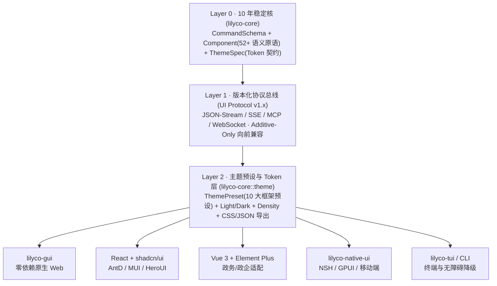

# 06 · Lilyco 10 年期 UI 抽象、多框架接入规范与演进路线（2026–2036）

> `--gui` 的默认 Web 入口使用 [shadcn/ui 适配器](../../lilyco-gui/web/README.md)。当前 Web 默认渲染器已经接入 shadcn/ui。

> **核心目标**：前端 UI 框架平均每 2–3 年换一代（Bootstrap → AntD/MUI → Chakra → shadcn/ui → NSH/GPUI → 2030+ 新框架），但业务代码和领域模型应该稳定运行 **10 年以上**。
> 本文规定了 Lilyco 如何将**「语义组件与主题契约」**与**「具体 UI 框架渲染器」**彻底解耦，确保今天写的业务代码在 2036 年换任何新 UI 框架时**一行不改**。

---

## 1. 四层解耦架构（为什么能活 10 年）



### 三条铁律
1. **业务代码零前端依赖**：任何业务 crate（如 `lilyco-web2cli`、`lilyco-vision`）只能引用 `lilyco::prelude::*` 的 `Component` 与 `ThemeSpec`，**禁止**在业务逻辑里写 React/Vue/CSS 类名。
2. **协议冻结、只增不删（Additive-Only）**：`Component` 以 `#[serde(tag = "kind", rename_all = "snake_case")]` 序列化；已发布的 `kind` 与字段类型在主版本 `1.x` 内**永久冻结**；新增字段必须带 `#[serde(default)]`。
3. **优雅降级（Graceful Fallback）**：任何渲染适配器遇到未来版本新增的未知 `kind` 时，**禁止崩溃或白屏**，必须按 `AdapterCapabilities.fallback`（`DegradeToCard` / `DegradeToText` / `DegradeToJson`）兜底渲染。

---

## 2. 7 大类组件 → `lilyco-core::view::Component` → 10 大框架映射表

所有业务视图均从 `lilyco-core/src/view.rs` 的 `Component` 枚举声明，下表给出各主流框架的标准映射：

| 类别 | Lilyco 语义原语（`Component` / `ArgKind`） | shadcn/ui | Ant Design | Material UI | Element Plus | NSH (`nsh.dev`) |
|---|---|---|---|---|---|---|
| **布局容器** | `Card` / `Section` / `Separator` / `ScrollArea` / `AspectRatio` / `Collapsible` | `Card` / `Separator` / `ScrollArea` | `Card` / `Divider` / `Collapse` | `Card` / `Divider` / `Accordion` | `el-card` / `el-divider` / `el-collapse` | `View` / `Card` / `ScrollView` |
| **导航结构** | `Tabs` / `Breadcrumb` / `NavigationMenu` / `Pagination` / `CommandPalette` | `Tabs` / `Breadcrumb` / `Command` | `Tabs` / `Breadcrumb` / `Steps` / `Pagination` | `Tabs` / `Breadcrumbs` / `Stepper` | `el-tabs` / `el-breadcrumb` / `el-steps` | `Tabs` / `NavigationStack` |
| **表单输入** | `ArgKind::{Flag,Text,Number,Enum,Path,List}` + `Form` / `Button` | `Input` / `Select` / `Switch` / `Checkbox` / `Button` | `Form` / `Input` / `Select` / `Upload` / `Cascader` | `TextField` / `Select` / `Switch` / `Slider` | `el-form` / `el-input` / `el-select` / `el-upload` | `Input` / `Select` / `Button` |
| **数据展示** | `Table` / `KeyValue` / `Stat` / `Badge` / `Avatar` / `Chart` / `Code` / `Markdown` / `Image` / `Empty` | `Table` / `Badge` / `Avatar` / `Card` | `Table` / `Descriptions` / `Statistic` / `Tag` | `DataGrid` / `Chip` / `Avatar` / `List` | `el-table` / `el-descriptions` / `el-tag` / `el-empty` | `List` / `Table` / `Badge` / `Image` |
| **反馈状态** | `Alert` / `Progress` / `Spinner` / `Skeleton` / `Toast` | `Alert` / `Progress` / `Skeleton` / `Sonner` | `Alert` / `Progress` / `Spin` / `Skeleton` / `message` | `Alert` / `LinearProgress` / `Skeleton` / `Snackbar` | `el-alert` / `el-progress` / `el-skeleton` / `ElMessage` | `Alert` / `Progress` / `Toast` |
| **浮层弹窗** | `Dialog` / `AlertDialog` / `Sheet (Drawer)` / `Popover` / `Tooltip` / `DropdownMenu` / `ContextMenu` | `Dialog` / `AlertDialog` / `Sheet` / `Popover` / `Tooltip` | `Modal` / `Popconfirm` / `Drawer` / `Popover` / `Tooltip` | `Dialog` / `Drawer` / `Popover` / `Tooltip` / `Menu` | `el-dialog` / `el-drawer` / `el-popover` / `el-tooltip` | `Dialog` / `Sheet` / `Popover` |
| **主题契约** | `ThemeSpec` + `ThemePreset`（10 套内置）+ `ColorMode` + `Density` | CSS Variables (`:root` / `.dark`) | `ConfigProvider` Design Tokens | `ThemeProvider` Palette + Elevation | `--el-color-*` CSS Vars | `ThemeProvider` Semantic Tokens |

---

## 3. 业务应用如何接入开发（3 步零耦合）

### 第 1 步：声明命令与参数（`#[derive(App)]` 或动态 `Registry`）
参数由 `lilyco-core::CommandSchema::validate_args` 唯一校验，自动映射到 CLI / TUI / Web / MCP：
```rust
#[derive(App)]
#[app(name = "proofread", run = "run_proofread", about = "国标资料校对")]
struct ProofreadCmd {
    #[arg(default = "default")]
    profile: String,
}
```

### 第 2 步：在 Handler 中发射语义视图（不写任何 HTML/React）
```rust
ctx.view("result", Component::Card {
    title: Some("校对报告".into()),
    description: Some("GB 32100-2015 / GB 11643-1999".into()),
    children: vec![
        Component::Alert { tone: Tone::Success, title: "通过".into(), message: "0 项错误".into() },
    ],
});
```

### 第 3 步：选择或切换主题预设（`lilyco-core::theme`）
```rust
use lilyco_core::theme::{ThemePreset, ThemeSpec};

let theme = ThemeSpec::from_preset(ThemePreset::ShadcnZinc);
let css = theme.to_css_vars(); // 任意 Web 渲染器直接注入 :root / .dark
```

---

## 4. 未来接入新 UI 框架的标准接口规范（Adapter Contract）

当 2028 年或 2030 年出现新 UI 框架 `FutureUI` 时，接入 Lilyco **只需实现一个独立适配器 crate/包**，无需修改 `lilyco-core` 或任何业务应用：

1. **声明能力清单（`AdapterCapabilities`）**：
   - 填写 `adapter_id`、`framework_name`、`protocol_version = "1.0"`、`supports_dark_mode`、`supports_density`、`fallback` 策略与 `supported_kinds` 清单；
   - 启动握手时调用 `caps.is_protocol_compatible()` 核验主版本兼容。
2. **消费 `ThemeSpec` 语义令牌**：
   - 将 `ThemeSpec.{light, dark}` 的 11 个语义色 + `shape` 的 5 个尺寸令牌映射到目标框架的 ThemeProvider / CSS 变量；
   - 严禁硬编码品牌色或写死浅色/深色字面量（终端日志区除外）。
3. **实现 `Component` 分发器 + 兜底分支**：
   - 按 `component.kind` 映射到目标框架原生组件；
   - 必须实现 `default / unknown` 分支：保留 `title` / `description` 并递归渲染 `children`（或按 `FallbackStrategy` 降级），严禁抛未捕获异常。
4. **通过四项准入门禁（Conformance Gate）**：
   - **Golden Fixture 测试**：能无损渲染 `lilyco-core` 全部 52+ 组件的 JSON 夹具；
   - **未知组件降级测试**：喂入 `{"kind":"future_widget_2032","title":"测试"}` 不崩溃且内容可见；
   - **WCAG 对比度门禁**：浅色/深色模式下正文 ≥ 4.5:1、控件边框 ≥ 3.0:1；
   - **响应式与键盘可达门禁**：320px / 390px / 768px / 1440px 无横向溢出（`scrollWidth <= innerWidth`），所有操作支持 Tab + Enter 键盘完成。

### 4.1 移动端与 Android WebView 强制交互规范

> 教训固化：桌面端侧栏直接缩小到手机端时，极易出现「横向导航滑不动」「隐藏侧栏导致授权/设置入口消失」「WebView 弱网白屏」三类典型故障。以下条款对所有 `lilyco` Web 应用与 WebView 壳强制生效：

1. **导航禁止隐式横向滚动**：移动端（`≤ 960px`）严禁在 `overflow: hidden` 容器内做横向滑动导航；一律改为 **2×2 / 自适应换行网格** 或 **底部固定 TabBar**，所有核心入口一屏直达。
2. **移动端功能零丢失**：桌面侧栏底部（如企业授权令牌、账号切换、主题切换）在窄屏折叠后，必须在对应主页面内提供等价可见入口。
3. **触控与防缩放**：移动端可点击热区 `≥ 44×44px`、`touch-action: manipulation`；输入框字号 `≥ 16px`（防止移动端聚焦自动放大）；底部预留 `env(safe-area-inset-bottom)` 全面屏手势区。
4. **WebView 壳弱网与原生能力兜底**：
   - 必须关闭误触双指缩放（`setSupportZoom(false)`）；
   - 必须实现 `onReceivedError` 自定义中文断网/DNS 异常重试页（禁止暴露系统 `ERR_NAME_NOT_RESOLVED` 白屏）；
   - 必须实现 `onShowFileChooser` 支持 `<input type="file">` 拍照/选图，以及 `onBackPressed` 返回键逐级后退。
5. **AI 原生网页自描述必备**：所有 Web 端默认暴露 `/llms.txt`、`/.well-known/agent.json`、`/openapi.json`、`/themes`，确保人与 AI Agent 共享同一份能力真相。

---

## 5. 10 年期演进与稳定性路线图（2026–2036）

| 阶段 | 时间窗 | 核心里程碑 | 稳定性承诺 |
|---|---|---|---|
| **Phase 1 · 契约固化** | 2026–2027 | 固化 `UI_PROTOCOL_VERSION = "1.0"`；内置 10 大框架 `ThemePreset`；在 `dev.lain42.top/ui-gallery` 提供实时对比展厅；补齐政务高频组件（`Stepper`/`Cascader`/`FileUpload`） | 所有已发布 `Component` kind 与 `ThemeSpec` 字段只增不删 |
| **Phase 2 · 多渲染器并跑** | 2027–2029 | `lilyco-gui`（零依赖轻量 Web）+ React/shadcn 适配器 + `lilyco-native-ui`（NSH/GPUI 原生桌面与移动端）共享同一套 JSON 契约与 Golden 测试集 | 业务 crate 零改动即可一键切换 Web / 桌面 / 移动端皮肤 |
| **Phase 3 · 生态插件化** | 2029–2032 | 第三方 UI 主题包与业务插件通过标准清单（`AdapterCapabilities` + `PluginDescriptor`）热插拔；引入废弃窗口制度（任何字段废弃前至少保留 **24 个月** 兼容期） | 主版本 `1.x` 保持二进制/JSON 全兼容 |
| **Phase 4 · 下一代交互演进** | 2032–2036 | 面向 AI 原生界面、空间计算/语音多模态，仍以 `lilyco-core` 语义事实源为唯一上游；即使需要 `UI_PROTOCOL_VERSION = "2.0"`，也提供 `v1 ↔ v2` 无损自动桥接层 | 2026 年编写的业务命令在 2036 年仍可直接运行 |
