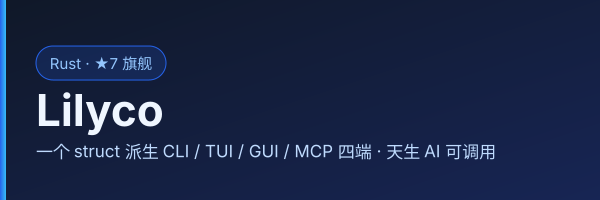

<div align="center">
  
</div>

# Lilyco

**One struct. Four interfaces (CLI / TUI / Web / MCP). Zero boilerplate. Cross-platform (Windows / Linux / Android).**

[](LICENSE)
[](https://www.rust-lang.org)
[](https://github.com/lilyco-42/lilyco/actions)
[](https://github.com/lilyco-42/lilyco/releases)

Lilyco is a Rust framework that generates **CLI**, **TUI**, **Web UI**, and a **standard MCP server** — from a single struct definition. Every app is an AI tool by default: agents (DeepSeek Harness, Claude Code, Cursor…) call it directly through MCP or JSON-stream. Same binary runs on Windows, Linux, and Android (Termux).

---

## Quick Start

```rust
use lilyco::prelude::*;

#[derive(App)]
#[app(run = "run_compress")]
struct ImgCompress {
    #[arg(must_exist = true)]
    input: PathBuf,
    #[arg(default = 75, range = 1..=100)]
    quality: u8,
}

fn run_compress(app: &ImgCompress, ctx: &Context) -> Result<serde_json::Value, AppError> {
    // your logic here; ctx emits progress, logs, cancellation
    Ok(serde_json::json!({ "done": true }))
}

fn main() {
    lilyco::run::<ImgCompress>();
}
```

From one struct you get:
- `imgpress --input photo.jpg --quality 50` — CLI
- Interactive TUI form (when run in a terminal)
- `imgpress --gui` — Web UI with SSE progress
- `imgpress --mcp` — MCP stdio server (AI agents call it directly)

---

## Framework Crates (`crates/`)

| Crate | What it does |
|---|---|
| [`lilyco-core`](crates/lilyco-core) | Context, Progress, AppError, SafetyTier, traits |
| [`lilyco-macros`](crates/lilyco-macros) | `#[derive(App)]` — generates CLI/TUI/Web/MCP |
| [`lilyco-cli`](crates/lilyco-cli) | clap-based CLI front-end |
| [`lilyco-tui`](crates/lilyco-tui) | crossterm interactive form |
| [`lilyco-gui`](crates/lilyco-gui) | Web UI (SSE progress) |
| [`lilyco-mcp`](crates/lilyco-mcp) | MCP stdio server |
| [`lilyco-ultra-ui`](crates/lilyco-ultra-ui) | JSON UI spec & renderer |
| [`lilyco`](crates/lilyco) | Facade — `lilyco::run::<T>()` dispatches all four ends |
| [`lilyco-dev`](crates/lilyco-dev) | Meta CLI (`lilyco new / build / run / doc`) |
| [`lilyco-example`](crates/lilyco-example) | Minimal 30-line four-surface example |

## Application Theme Repositories (Topic: `#lilyco`)

Application crates have been split into independent theme repositories (all tagged with GitHub topic **`lilyco`**, see [docs/THEME-REPOS.md](docs/THEME-REPOS.md)):

| Binary | Crate | Repository | What it does |
|---|---|---|---|
| `lenv` | `lilyco-env-cli` | [Lyco-team/lilyco-env](https://github.com/Lyco-team/lilyco-env) | Cross-platform env doctor, JSON/TOML/YAML/INI editor, chsrc-style mirrors & kiri forge |
| `lbin` | `lilyco-binfmt` | [Lyco-team/lilyco-tools](https://github.com/Lyco-team/lilyco-tools) | Office file reader (docx/xlsx/pptx/odt) |
| `lgrep` | `lilyco-grep` | [Lyco-team/lilyco-tools](https://github.com/Lyco-team/lilyco-tools) | Fast grep |
| `lfiles` | `lilyco-files` | [Lyco-team/lilyco-tools](https://github.com/Lyco-team/lilyco-tools) | File ops |
| `lplc` | `lilyco-plc` | [Lyco-team/lilyco-tools](https://github.com/Lyco-team/lilyco-tools) | PLC / companion board control |
| `lbrush` | `lilyco-brush` | [Lyco-team/lilyco-media](https://github.com/Lyco-team/lilyco-media) | Rust-native bash on Windows |
| `lffmpeg` | `lilyco-ffmpeg` | [Lyco-team/lilyco-media](https://github.com/Lyco-team/lilyco-media) | ffmpeg transcode/resize/trim with live progress |
| `lvision` | `lilyco-vision` | [Lyco-team/lilyco-media](https://github.com/Lyco-team/lilyco-media) | Vision / OCR |
| `lsrt` | `lilyco-srt` | [Lyco-team/lilyco-media](https://github.com/Lyco-team/lilyco-media) | Auto-subtitle: faster-whisper ASR + ffmpeg burn-in |
| `lpet` | `lilyco-pet` | [Lyco-team/lilyco-media](https://github.com/Lyco-team/lilyco-media) | Pet companion |
| `laic` | `lilyco-aic` | [Lyco-team/lilyco-ai](https://github.com/Lyco-team/lilyco-ai) | Alice in Cradle tooling |
| `lmpkg` | `lilyco-mpkg` | [Lyco-team/lilyco-ai](https://github.com/Lyco-team/lilyco-ai) | Memory package registry |
| — | UI / Desktop shells | [Lyco-team/lilyco-ui](https://github.com/Lyco-team/lilyco-ui) | Tauri, Graphite, GTK4 native-ui, floating window |
| — | Desktop Studios | [Lyco-team/lilyco-studios](https://github.com/Lyco-team/lilyco-studios) | asset-studio, vision-studio, media-studio |
| — | Agent & Manager | [Lyco-team/lilyco-agent](https://github.com/Lyco-team/lilyco-agent) | lilyco-manager, lilyco-toolhub, tiny-agent, tiny_lilyco |

Install any app binary:
```bash
cargo binstall lilyco-ffmpeg   # or lilyco-srt, lilyco-brush, ...
```

---

## Documentation

- [Why Lilyco](docs/WHY.md) — the problem and design motivation
- [Quick Start](docs/QUICKSTART.md) — full worked example (imgpress)
- [Architecture](docs/ARCHITECTURE.md) — how the four ends dispatch
- [Architecture detail](docs/ARCH-DETAIL.md) — design principles + ASCII diagram
- [Crate Reference](docs/CRATE-REFERENCE.md) — core traits, types, macros, per-crate API
- [Type → Widget mapping](docs/TYPE-WIDGET.md)
- [AI Integration](docs/AI-INTEGRATION.md) — MCP, JSON Schema, progress protocol
- [Examples](docs/EXAMPLES.md) — more apps built on lilyco
- [UI Guidelines](docs/ui/README.md) — 入门介绍 + 手把手教程 + 设计语言 + 组件参考（内置 Web 端与 React 映射）
- [DSH Integration](docs/DSH.md)
- [Testing](docs/TESTING.md)
- [Port Allocation](docs/PORT-ALLOCATION.md) — 4200 金融、4300 游戏…按用途分段；manager 段内分配、冲突漂移、`GET /api/ports` 预警
- [Development Standards](docs/DEVELOPMENT-STANDARDS.md) — 模块五件套、测试矩阵、端口规则、发布三件套
- [Installation](docs/INSTALL.md)
- [Roadmap](docs/ROADMAP.md)
- [Research & references](docs/RESEARCH.md)

---

## License

MIT OR Apache-2.0
